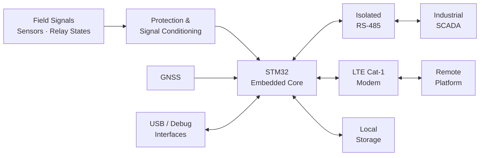
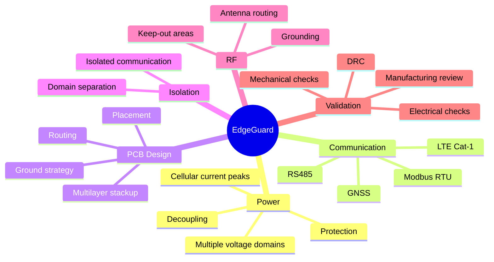

<div align="center">

# EDGEGUARD

### Industrial Edge Monitoring Platform

**From field information to industrial supervision and remote connectivity —  
through embedded hardware, communication, multilayer PCB design, and real manufacturing.**

<br>


</div>

---

## Overview

EdgeGuard was developed during my PFA internship as an embedded monitoring and communication platform for transformer cabinets.

The objective was to bring several functions together on a single industrial electronic board: local processing, field communication, remote connectivity, monitoring, data storage, and diagnostics.

The system is built around an **STM32-based core** and combines:

- Isolated **RS-485 / Modbus RTU**
- **LTE Cat-1** cellular connectivity
- **GNSS** capability
- Local data storage
- Fault and relay-state monitoring
- USB and diagnostic interfaces
- Dedicated power and protection circuits

The project went from the first system requirements to a complete multilayer PCB and finally to a real manufactured board.

---

# System Architecture


---

# From Intent to Copper

The project did not start with a PCB.

It started with a set of system requirements that had to be translated into a real electronic architecture.

```text
Requirements
     ↓
System Architecture
     ↓
Component Selection
     ↓
Schematic Design
     ↓
Power + Isolation Strategy
     ↓
PCB Placement
     ↓
Routing
     ↓
Electrical & Mechanical Checks
     ↓
Manufacturing
```

Every stage influenced the next one.

A communication decision affected isolation.  
A modem decision affected the power architecture.  
The power architecture affected placement.  
Placement affected routing.

And eventually, all of these decisions shaped the final board.

---

# The Board Has Multiple Worlds

One of the main challenges was bringing several very different electrical functions together on the same PCB.

### 🧠 Embedded Processing

The STM32 acts as the central controller of the system, managing communication, monitoring and the different peripherals connected to the board.

### 🔌 Industrial Communication

An isolated RS-485 interface allows communication with industrial equipment using **Modbus RTU**.

### 📡 Cellular Connectivity

An LTE Cat-1 modem provides remote communication between the transformer cabinet and external systems.

### 🛰️ GNSS

GNSS capability can provide positioning information when required by the application.

### 💾 Local Storage

Local memory allows important information to be stored even when remote communication is temporarily unavailable.

### ⚡ Power

Different parts of the system have very different power requirements.

Special attention was given to:

- Power distribution
- Cellular modem current peaks
- Local decoupling
- Filtering
- Protection
- Grounding

### 🛡️ Isolation

The industrial communication interface required a clear separation between different electrical domains while still allowing reliable data exchange.

---

# Decisions That Shaped the Board

Some design choices had a direct impact on the final PCB.

| Engineering Decision | Why It Mattered |
|---|---|
| Isolated RS-485 | Keeps the industrial communication side separated from the main logic |
| Multilayer PCB | Provides better grounding, routing and power distribution |
| Dedicated modem power path | Supports the high current peaks required by cellular communication |
| RF routing strategy | Helps maintain reliable cellular and GNSS communication |
| Protection circuits | Protect sensitive electronics from the external environment |
| Structured grounding | Helps different electrical sections work together correctly |
| Local storage | Keeps important data available even without remote communication |
| Diagnostic interfaces | Makes development, testing and maintenance easier |

These decisions were connected.

Changing one part of the design could affect power, placement, routing or even the mechanical layout of the board.

---

# Engineering Constraints Map



---

# From Screen to Board

One of the most rewarding parts of the project was seeing the design move from the computer screen to real hardware.

```text
System Architecture
        ↓
Schematic Design
        ↓
PCB Layout
        ↓
3D Validation
        ↓
Manufacturing Files
        ↓
Physical PCB
```


Once the PCB is manufactured, every earlier design choice became real.

Connector positions, footprints, dimensions, clearances and component placement were no longer just elements on a screen — they became physical parts of the final system.

---

    MCU <--> LTE
    LTE <--> CLOUD

    GNSS --> MCU
    MCU <--> MEMORY
    DEBUG <--> MCU
