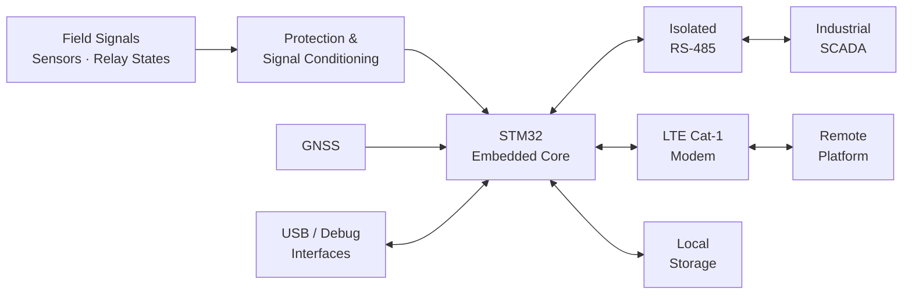
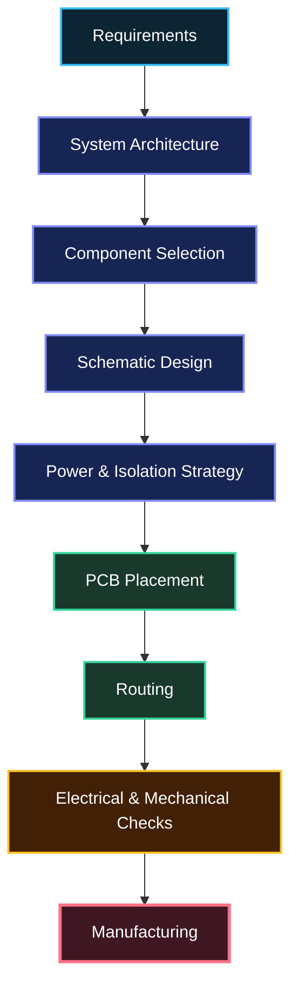
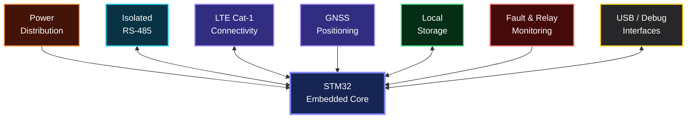
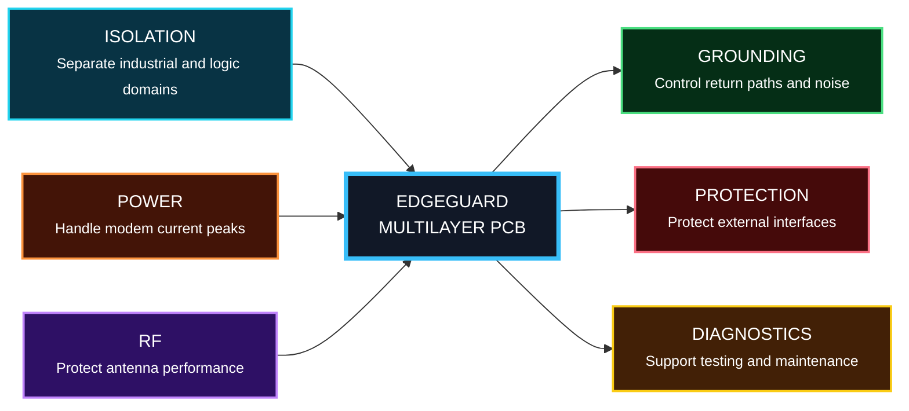
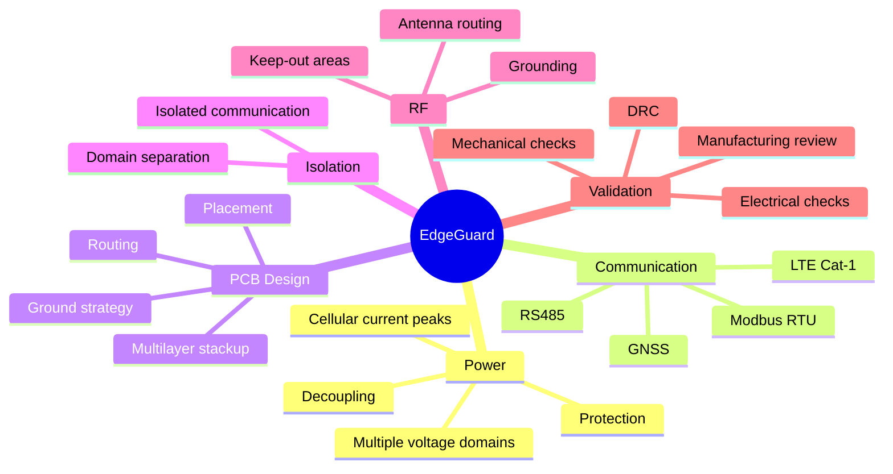

<div align="center">

# EDGEGUARD

### Industrial Edge Monitoring Platform

**From field information to industrial supervision and remote connectivity —  
through embedded hardware, communication, multilayer PCB design, and real manufacturing.**

<br>


</div>

---

## Overview

EdgeGuard was developed during my PFA internship as an embedded monitoring and communication platform for transformer cabinets.

The objective was to bring several functions together on a single industrial electronic board: local processing, field communication, remote connectivity, monitoring, data storage, and diagnostics.

The system is built around an **STM32-based core** and combines:

- Isolated **RS-485 / Modbus RTU**
- **LTE Cat-1** cellular connectivity
- **GNSS** capability
- Local data storage
- Fault and relay-state monitoring
- USB and diagnostic interfaces
- Dedicated power and protection circuits

The project went from the first system requirements to a complete multilayer PCB and finally to a real manufactured board.

---

# System Architecture


---
## From Intent to Copper



Every stage influenced the next one.

A communication decision affected isolation.  
A modem decision affected the power architecture.  
The power architecture affected placement.  
Placement affected routing.

And eventually, all of these decisions shaped the final board.

---

## The Board Has Multiple Worlds

One of the main challenges was making several very different electrical functions coexist on the same PCB.



The board brings together several different electrical environments:

- **Embedded processing** — the STM32 is the central controller of the system.
- **Industrial communication** — isolated RS-485 provides reliable Modbus RTU communication.
- **Cellular connectivity** — LTE Cat-1 enables remote communication.
- **GNSS** — provides positioning capability when required.
- **Local storage** — keeps important information available locally.
- **Monitoring** — handles fault and relay-state information.
- **Power** — supplies sections with very different electrical requirements.
- **Debug interfaces** — support programming, testing and diagnostics.

The real challenge was not adding these functions individually, but making all of them work reliably together on the same board.

---

---

## Decisions That Shaped the Board

The final PCB was shaped by a few key engineering decisions. Each one solved a different constraint of the system.



### Why these choices mattered

| Decision | Impact on the design |
|---|---|
| **Isolated RS-485** | Kept the industrial communication side separated from the MCU domain |
| **Dedicated modem power path** | Helped support the high current demand of cellular communication |
| **RF-aware placement** | Kept sensitive RF paths short and protected antenna areas |
| **Multilayer architecture** | Improved grounding, routing and power distribution |
| **Protection circuits** | Added protection between the board and the external environment |
| **Structured grounding** | Helped different electrical sections coexist more reliably |
| **Diagnostic interfaces** | Made programming, testing and troubleshooting easier |

> The board was not shaped by one big decision.  
> It was shaped by many small decisions that had to work together.

---
# Engineering Constraints Map



---

# From Screen to Board

One of the most rewarding parts of the project was seeing the design move from the computer screen to real hardware.

```text
System Architecture
        ↓
Schematic Design
        ↓
PCB Layout
        ↓
3D Validation
        ↓
Manufacturing Files
        ↓
Physical PCB
```


Once the PCB is manufactured, every earlier design choice became real.

Connector positions, footprints, dimensions, clearances and component placement were no longer just elements on a screen — they became physical parts of the final system.

---

    MCU <--> LTE
    LTE <--> CLOUD

    GNSS --> MCU
    MCU <--> MEMORY
    DEBUG <--> MCU
