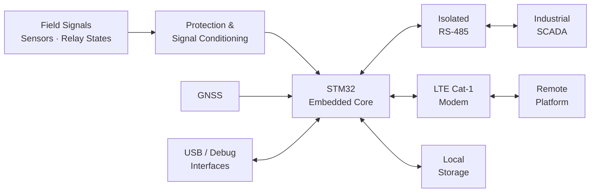

<div align="center">

# EDGEGUARD

### Industrial Edge Monitoring Platform

**From field information to industrial supervision and remote connectivity —  
through embedded hardware, communication, multilayer PCB design, and real manufacturing.**

<br>


</div>

---

## Overview

EdgeGuard was developed during my PFA internship as an embedded monitoring and communication platform for transformer cabinets.

The objective was to bring several functions together on a single industrial electronic board: local processing, field communication, remote connectivity, monitoring, data storage, and diagnostics.

The system is built around an **STM32-based core** and combines:

- Isolated **RS-485 / Modbus RTU**
- **LTE Cat-1** cellular connectivity
- **GNSS** capability
- Local data storage
- Fault and relay-state monitoring
- USB and diagnostic interfaces
- Dedicated power and protection circuits

The project went from the first system requirements to a complete multilayer PCB and finally to a real manufactured board.

---

# System Architecture


<div align="center">

# EDGEGUARD

### Industrial Edge Monitoring Platform

**From field information to industrial supervision and remote connectivity —  
through embedded hardware, communication, multilayer PCB design, and real manufacturing.**

<br>


</div>

---

## Overview

EdgeGuard was developed during my PFA internship as an embedded monitoring and communication platform for transformer cabinets.

The objective was to bring several functions together on a single industrial electronic board: local processing, field communication, remote connectivity, monitoring, data storage, and diagnostics.

The system is built around an **STM32-based core** and combines:

- Isolated **RS-485 / Modbus RTU**
- **LTE Cat-1** cellular connectivity
- **GNSS** capability
- Local data storage
- Fault and relay-state monitoring
- USB and diagnostic interfaces
- Dedicated power and protection circuits

The project went from the first system requirements to a complete multilayer PCB and finally to a real manufactured board.

---

# System Architecture

```mermaid
flowchart LR

    FIELD["Field Signals<br/>Sensors · Relay States"]

    INPUT["Protection &<br/>Signal Conditioning"]

    MCU["STM32<br/>Embedded Core"]

    RS485["Isolated<br/>RS-485"]

    SCADA["Industrial<br/>SCADA"]

    LTE["LTE Cat-1<br/>Modem"]

    CLOUD["Remote<br/>Platform"]

    GNSS["GNSS"]

    MEMORY["Local<br/>Storage"]

    DEBUG["USB / Debug<br/>Interfaces"]

    FIELD --> INPUT
    INPUT --> MCU

    MCU <--> RS485
    RS485 <--> SCADA

    MCU <--> LTE
    LTE <--> CLOUD

    GNSS --> MCU
    MCU <--> MEMORY
    DEBUG <--> MCU
