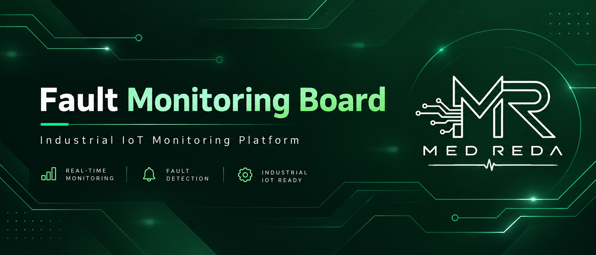
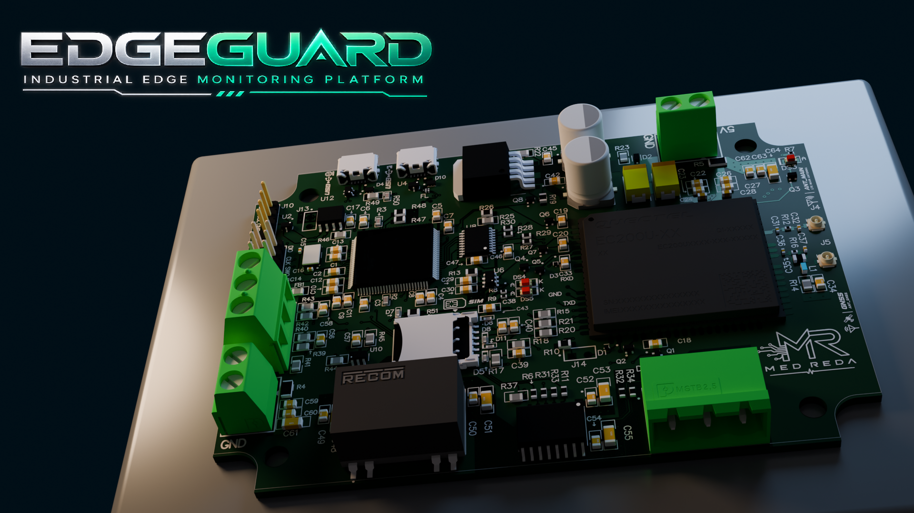
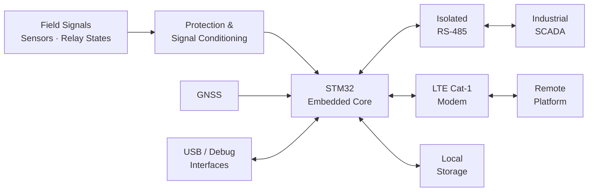
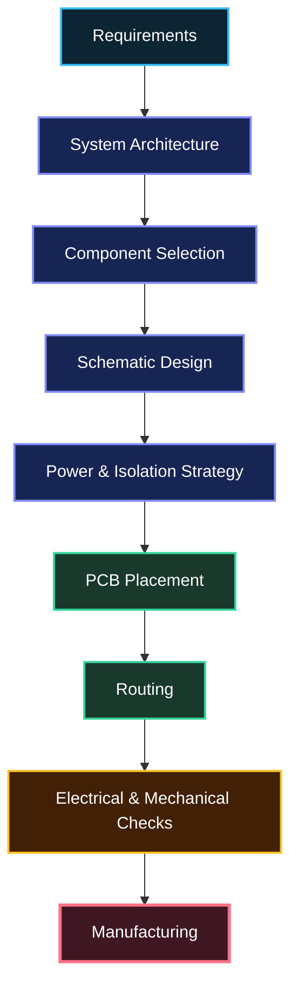
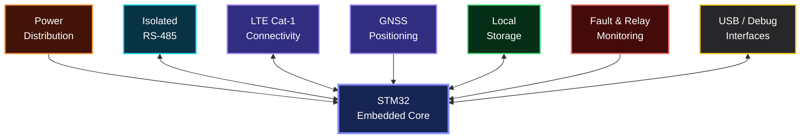
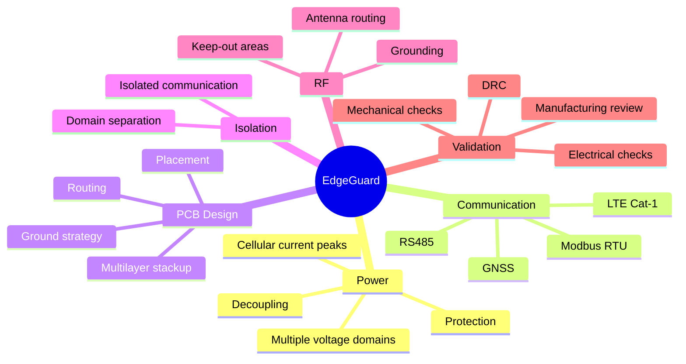
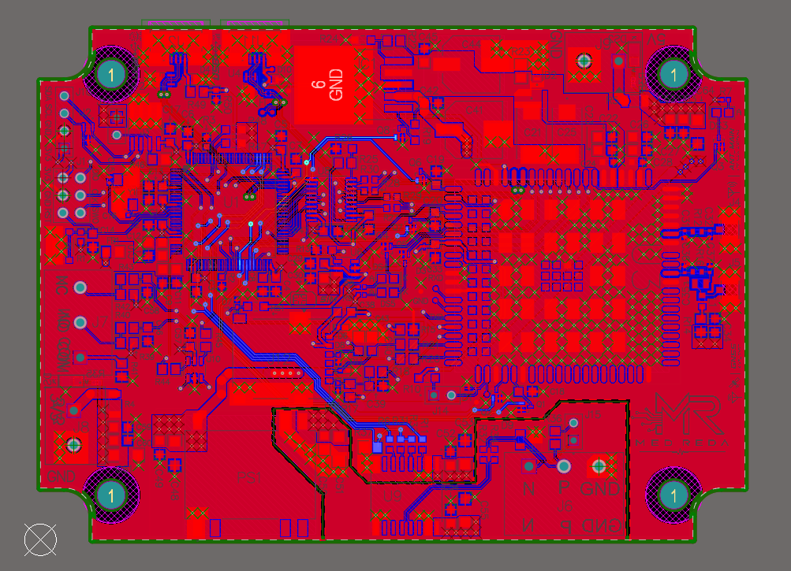
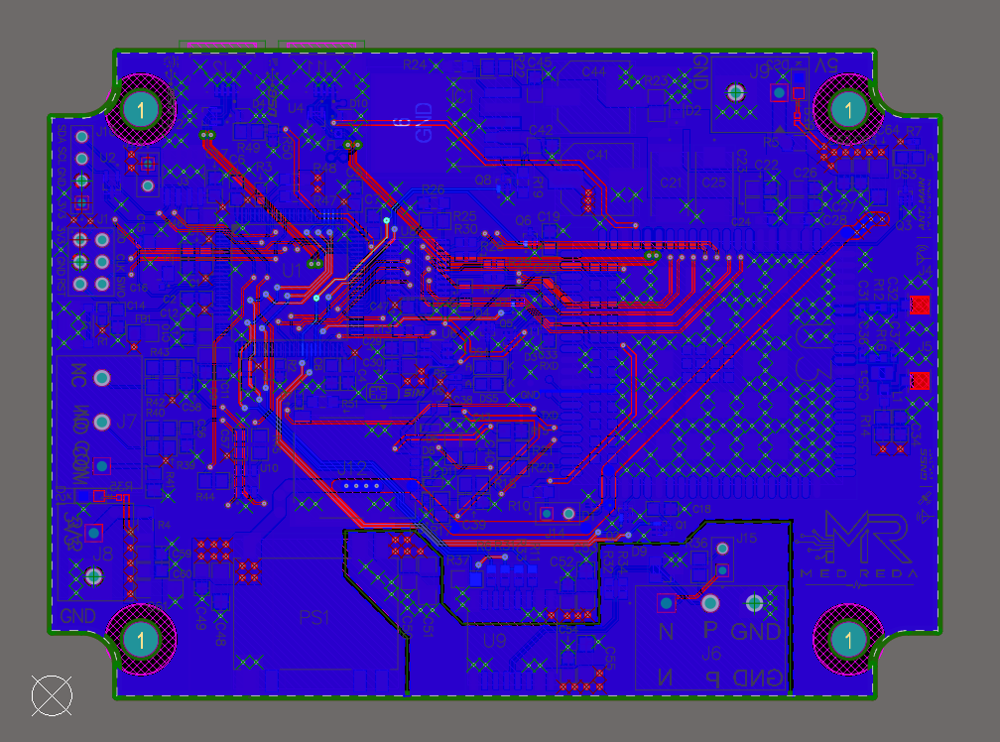
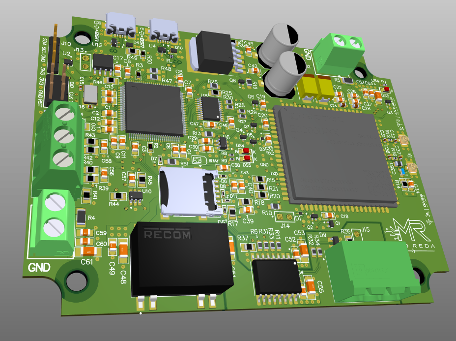

  

---

# Overview

EdgeGuard was developed during my PFA internship as an industrial electrical fault monitoring and remote supervision unit for power distribution systems.

The objective was to bring several functions together on a single industrial electronic board: local processing, field communication, remote connectivity, monitoring, data storage, and diagnostics.

The system is built around an **STM32-based core** and combines:

- Isolated **RS-485 / Modbus RTU**
- **LTE Cat-1** cellular connectivity
- **GNSS** capability
- Local data storage
- Fault and relay-state monitoring
- USB and diagnostic interfaces
- Dedicated power and protection circuits

 

---

# System Architecture

---
## From Intent to Copper

Every stage influenced the next one.

A communication decision affected isolation.  
A modem decision affected the power architecture.  
The power architecture affected placement.  
Placement affected routing.

And eventually, all of these decisions shaped the final board.

---

## The Board Has Multiple Worlds

One of the main challenges was making several very different electrical functions coexist on the same PCB.

The board brings together several different electrical environments:

- **Embedded processing** — the STM32 is the central controller of the system.
- **Industrial communication** — isolated RS-485 provides reliable Modbus RTU communication.
- **Cellular connectivity** — LTE Cat-1 enables remote communication.
- **GNSS** — provides positioning capability when required.
- **Local storage** — keeps important information available locally.
- **Monitoring** — handles fault and relay-state information.
- **Power** — supplies sections with very different electrical requirements.
- **Debug interfaces** — support programming, testing and diagnostics.

The real challenge was not adding these functions individually, but making all of them work reliably together on the same board.

---

---

## Decisions That Shaped the Board

The final PCB was shaped by a few key engineering decisions. Each one solved a different constraint of the system.

```mermaid
flowchart TB

    PCB(["EDGEGUARD<br/><b>MULTILAYER PCB</b>"]):::pcb

    subgraph ROBUST["ELECTRICAL ROBUSTNESS"]
        direction LR
        ISO["ISOLATION<br/><small>Separate field and logic domains</small>"]:::iso
        PROT["PROTECTION<br/><small>Protect external interfaces</small>"]:::prot
    end

    subgraph INTEGRITY["SIGNAL & POWER INTEGRITY"]
        direction LR
        POWER["POWER<br/><small>Handle modem current demand</small>"]:::power
        GND["GROUNDING<br/><small>Control return paths</small>"]:::gnd
        RF["RF<br/><small>Preserve antenna performance</small>"]:::rf
    end

    subgraph SERVICE["VALIDATION & SERVICEABILITY"]
        direction LR
        DIAG["DIAGNOSTICS<br/><small>Enable test and maintenance</small>"]:::diag
    end

    ROBUST ==> PCB
    INTEGRITY ==> PCB
    SERVICE ==> PCB

    classDef pcb fill:#172554,stroke:#60A5FA,color:#FFFFFF,stroke-width:4px;

    classDef iso fill:#083344,stroke:#22D3EE,color:#FFFFFF,stroke-width:2px;
    classDef prot fill:#450A0A,stroke:#FB7185,color:#FFFFFF,stroke-width:2px;

    classDef power fill:#431407,stroke:#FB923C,color:#FFFFFF,stroke-width:2px;
    classDef gnd fill:#052E16,stroke:#4ADE80,color:#FFFFFF,stroke-width:2px;
    classDef rf fill:#2E1065,stroke:#C084FC,color:#FFFFFF,stroke-width:2px;

    classDef diag fill:#422006,stroke:#FACC15,color:#FFFFFF,stroke-width:2px;

    style ROBUST fill:#0D1117,stroke:#22D3EE,stroke-width:1px
    style INTEGRITY fill:#0D1117,stroke:#C084FC,stroke-width:1px
    style SERVICE fill:#0D1117,stroke:#FACC15,stroke-width:1px
```

### Why these choices mattered

| Decision | Impact on the design |
|---|---|
| **Isolated RS-485** | Kept the industrial communication side separated from the MCU domain |
| **Dedicated modem power path** | Helped support the high current demand of cellular communication |
| **RF placement** | Kept sensitive RF paths short and protected antenna areas |
| **Multilayer architecture** | Improved grounding, routing and power distribution |
| **Protection circuits** | Added protection between the board and the external environment |
| **Structured grounding** | Helped different electrical sections coexist more reliably |
| **Diagnostic interfaces** | Made programming, testing and troubleshooting easier |

---
# Engineering Constraints Map

---

## PCB Design

This is where the system architecture became a physical board.

The design was implemented as a **4-layer PCB**, with the placement and routing organized around power, communication, isolation, RF and mechanical constraints.

<table>
  <tr>
    <td align="center">
      
       
      <b>Top Layer</b>
    </td>
    <td align="center">
      
       
      <b>Bottom Layer</b>
    </td>
  </tr>
</table>

  
   
  <b>3D Assembly View</b>

### Design Focus

| ⚡ Power Integrity | 🔌 Industrial Interfaces | 📡 RF & Connectivity | 🧩 PCB Integration |
|:---:|:---:|:---:|:---:|
| Stable power distribution | Isolated RS-485 | LTE Cat-1 integration | Functional placement |
| Local decoupling | Modbus communication | GNSS capability | Multilayer routing |
| Cellular current peaks | Interface protection | Antenna keep-out | Ground strategy |
| Protection stages | Domain separation | Short RF paths | Mechanical checks |

 

### From Placement to Routing

The goal was not simply to connect every component.

The goal was to make the board **electrically reliable, physically organized and ready to manufacture**.

---
---

## Technologies & Tools

  <b>Hardware & Processing</b>

  
  
  

  <b>Industrial & Remote Communication</b>

  
  
  
  
  

  <b>Simulation & Development</b>

  
  
  
  

  <b>PCB & Hardware Design</b>

  
  
  
  
  

  <b>Engineering Workflow</b>

  
  
  
  
  

---

---

## What Is Intentionally Not Included

This repository is meant to present the **project process, architecture and design decisions** behind the project.

Some production material is intentionally not published.

| Not Included | Reason |
|---|---|
| **Complete Schematics** | Production design details are kept private |
| **Gerber Files** | Manufacturing files are not part of the public repository |
| **Complete BOM** | Component sourcing and production details are excluded |
| **Production Firmware** | Only sanitized examples may be shared in the future |
| **Internal Configuration Data** | Project specific configuration is kept private |

 

> **The goal of this repository is to share the engineering journey without exposing sensitive production material.**

---

