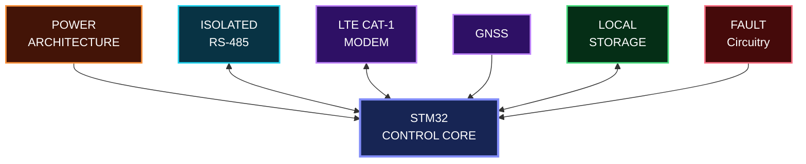
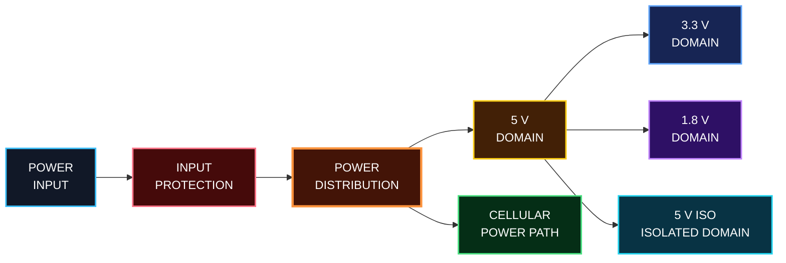
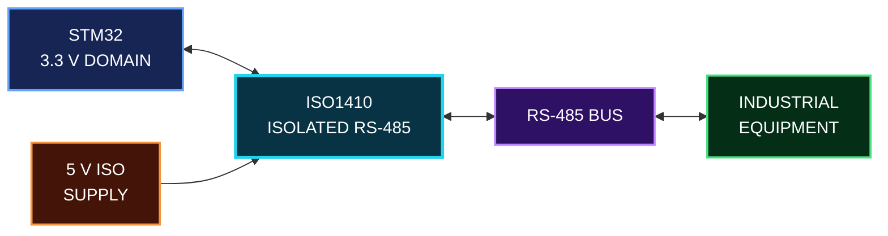
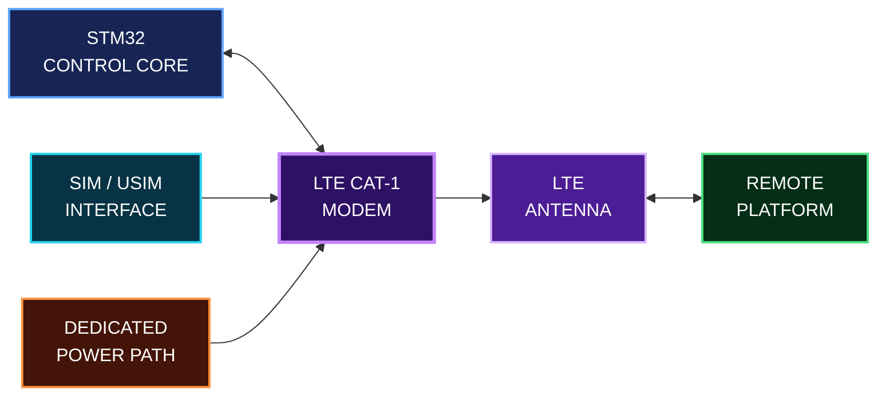
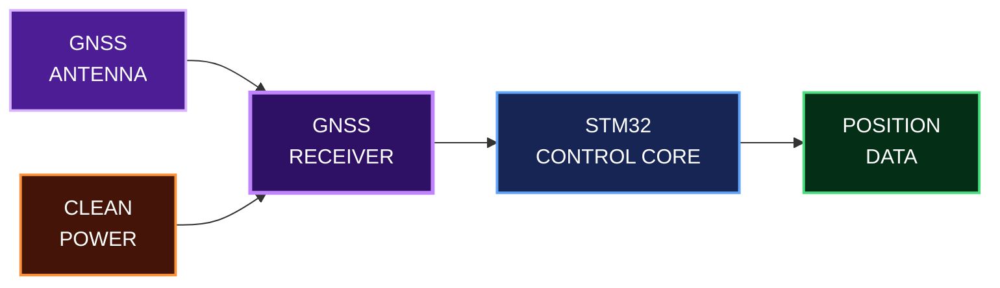

# Engineering Design Notes

This section focuses on the technical decisions that shaped EdgeGuard.

The goal is not to reproduce the complete production design, but to explain the main engineering challenges, trade-offs and validation steps behind the hardware.

---

## System Design Philosophy

EdgeGuard combines several electrical environments on the same board:

- Industrial communication
- Cellular connectivity
- GNSS
- Local storage
- Fault monitoring
- Power conversion

---

---

## Power Architecture

The board had to supply several sections with different voltage and current requirements.

Instead of treating power as a single rail, the design was organized around several electrical domains:

- **5 V** — main intermediate supply
- **3.3 V** — MCU and digital logic
- **5 V ISO** — isolated communication domain
- **1.8 V** — low-voltage interface domain

The cellular section also required special attention because of its short high-current peaks during network activity.

The main design points were:

- Keeping the different voltage domains clearly organized
- Providing local decoupling close to the loads
- Supplying enough transient current for the cellular modem
- Keeping the isolated supply separated from the main logic domain
- Minimizing high-current power paths
- Protecting the board at the power entry

  ---

## Industrial Communication & Isolation

The industrial communication interface is based on **RS-485 / Modbus RTU** and is electrically isolated from the main STM32 domain.

The isolation helps protect the logic side of the board from disturbances coming from the industrial environment.

> **Isolation was treated as both an electrical and a physical PCB constraint.**

---

## LTE Cat-1 & RF Integration

The cellular section gives EdgeGuard remote connectivity through an **LTE Cat-1 modem**.

Compared with the MCU and low-power logic, the modem introduced two important challenges:

- High transient current demand
- RF routing and antenna integration

### Power Considerations

The modem can generate short current peaks during transmission, so the power path was designed with:

- Bulk capacitance close to the modem
- Local high-frequency decoupling
- Short and wide power paths
- Protection at the supply entry
- Careful return-current paths

### RF Considerations

The RF section required additional PCB constraints:

- Controlled **50 Ω antenna routing**
- Short RF traces
- Antenna keep-out area
- Continuous ground reference
- Separation from noisy power and digital sections
- Careful placement of the modem and antenna connector

> **The cellular section influenced both the power architecture and the physical PCB layout.**

---
---

## GNSS Integration

GNSS capability was integrated to allow the system to provide positioning information when needed.

The GNSS section had to be treated carefully because RF signals are sensitive to routing, grounding and nearby noise sources.

### Design Considerations

- Short RF path between the GNSS section and antenna
- Continuous ground reference
- Separation from noisy digital and power circuits
- Careful antenna placement and keep-out
- Local decoupling close to the GNSS circuitry
- Reliable communication with the STM32

> **With GNSS, placement and routing become part of the RF design, not just the PCB layout.**

---
