# Engineering Design Notes

This section focuses on the technical decisions that shaped EdgeGuard.

The goal is not to reproduce the complete production design, but to explain the main engineering challenges, trade-offs and validation steps behind the hardware.

---

## System Design Philosophy

EdgeGuard combines several electrical environments on the same board:

- Industrial communication
- Cellular connectivity
- GNSS
- Local storage
- Fault monitoring
- Power conversion

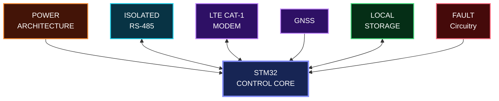

---

---

## Power Architecture

The board had to supply several sections with different voltage and current requirements.

Instead of treating power as a single rail, the design was organized around several electrical domains:

- **5 V** — main intermediate supply
- **3.3 V** — MCU and digital logic
- **5 V ISO** — isolated communication domain
- **1.8 V** — low-voltage interface domain

The cellular section also required special attention because of its short high-current peaks during network activity.

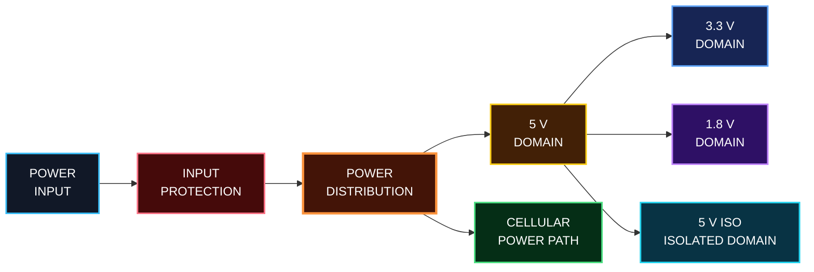

The main design points were:

- Keeping the different voltage domains clearly organized
- Providing local decoupling close to the loads
- Supplying enough transient current for the cellular modem
- Keeping the isolated supply separated from the main logic domain
- Minimizing high-current power paths
- Protecting the board at the power entry

  ---

## Industrial Communication & Isolation

The industrial communication interface is based on **RS-485 / Modbus RTU** and is electrically isolated from the main STM32 domain.

The isolation helps protect the logic side of the board from disturbances coming from the industrial environment.

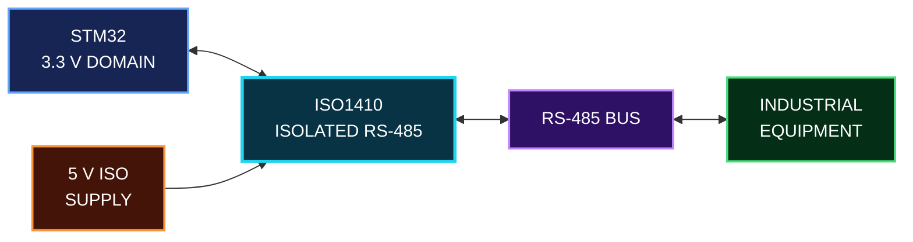

> **Isolation was treated as both an electrical and a physical PCB constraint.**

---

---

## LTE Cat-1 Integration
The LTE modem introduced its own power behavior, logic voltage domain, SIM interface and RF path.  
Integrating these correctly was therefore a combination of **digital interfacing, power integrity and RF design**.

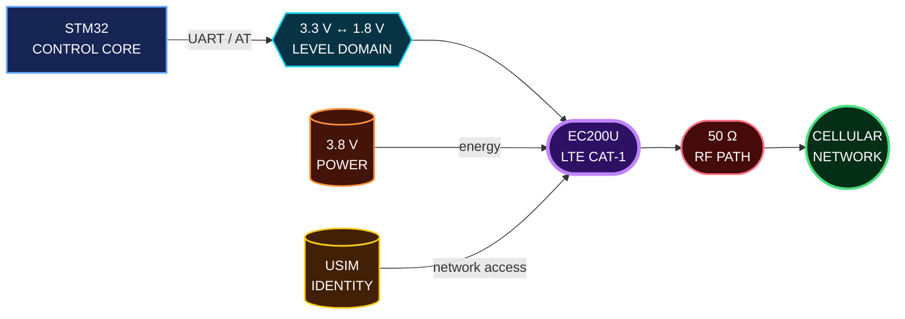

### Power Became Part of the Communication Design

The EC200U operates around **3.8 V** and its supply must remain stable while the modem changes operating state and transmits over the cellular network.  
This influenced the power path width and the physical position of the modem power network.

  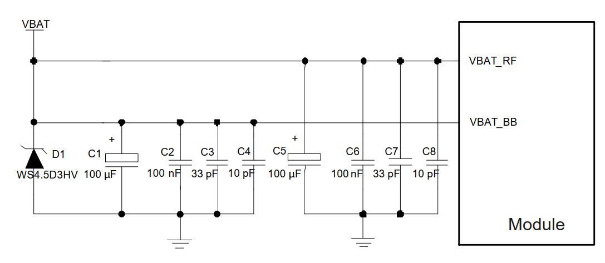
    
  <b>Cellular Modem Power Reference</b>
   
  
    LTE reference topology showing local energy storage, high-frequency
    decoupling and separate VBAT_RF / VBAT_BB paths.
  

The manufacturer reference also separates the supply toward **VBAT_RF** and **VBAT_BB**, with local bulk and high-frequency capacitors placed close to the module.

For EdgeGuard, this translated into a short, low-impedance modem supply path with local bulk capacitance and decoupling close to the cellular section.

---

### Two Logic Domains Had to Meet

The STM32 operates in a **3.3 V logic environment**, while the EC200U UART belongs to a **1.8 V domain**.

Instead of connecting both devices directly, a dedicated level-translation stage was placed between the controller and modem.

  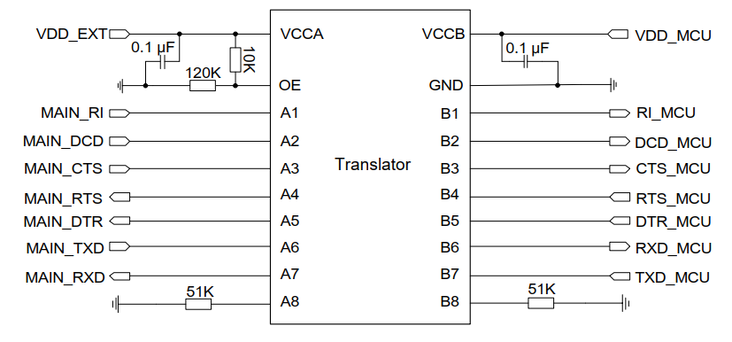
    
  <b>UART Level-Translation Reference</b>
   
  
    Manufacturer reference showing the interface between the modem's
    1.8 V UART domain and an external MCU logic domain.
  

This interface provides the communication path used for **AT commands, modem control and data exchange**.

---

### Network Access Starts at the SIM Interface

The cellular link also depends on a reliable USIM interface.

The SIM signals were therefore treated as an external interface with attention to local filtering, protection and routing between the modem and SIM holder.

  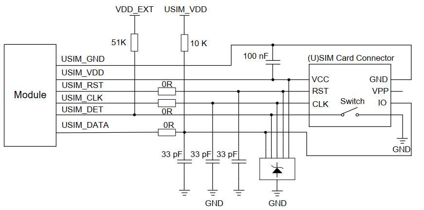
    
  <b>USIM Interface Reference</b>
   
  
    Reference architecture for SIM power, clock, reset and data signals,
    including filtering and protection close to the connector.
  

The EC200U supports both **1.8 V and 3.0 V USIM operation**, allowing the modem to manage the SIM supply according to the inserted card.

---

### The Last Centimeters Became RF Design

The EC200U main antenna interface is specified for **50 Ω characteristic impedance**, so the antenna connection was treated as a controlled-impedance RF path.

  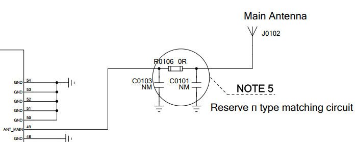
    
  <b>Main Antenna Matching Reference</b>
   
  
    LTE reference showing the reserved π-matching network between
    ANT_MAIN and the external antenna connection.
  

This influenced trace geometry, ground continuity, component placement and the distance between the modem and antenna connection.

 

  <i>Reference: LTE Series Hardware Design and Reference Design documentation.</i>

---

## GNSS Integration

GNSS capability was integrated to allow the system to provide positioning information when needed.

The GNSS section had to be treated carefully because RF signals are sensitive to routing, grounding and nearby noise sources.

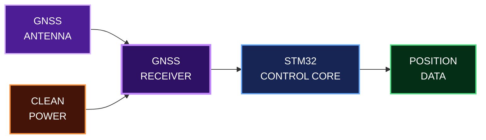

### Design Considerations

- Short RF path between the GNSS section and antenna
- Continuous ground reference
- Separation from noisy digital and power circuits
- Careful antenna placement and keep-out
- Local decoupling close to the GNSS circuitry
- Reliable communication with the STM32

> **With GNSS, placement and routing become part of the RF design, not just the PCB layout.**

---
 

<h3 align="center">GNSS Design References</h3>

  
    Manufacturer recommendations used as references for the antenna interface,
    impedance control and RF routing strategy.
  

 

  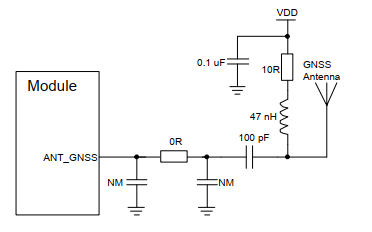
    
  <b>GNSS Antenna Reference Circuit</b>
   
  
    Recommended antenna interface and matching network for the GNSS RF path.
  

 

<table>
<tr>
<td align="center" width="50%">
<b>50 Ω GNSS Interface</b>  
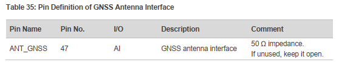  
The ANT_GNSS interface is specified with a characteristic impedance of 50 Ω.
</td>
<td align="center" width="50%">
<b>4-Layer RF Routing Reference</b>  
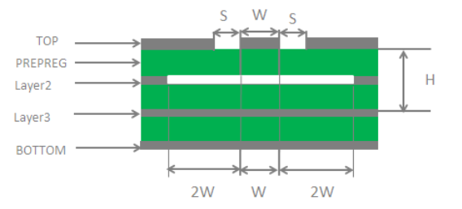  
Coplanar-waveguide geometry used as a reference for controlled-impedance RF routing.
</td>
</tr>
</table>

 

  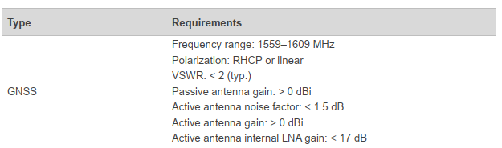
    
  <b>GNSS Antenna Requirements</b>
   
  
    Manufacturer requirements covering operating frequency, VSWR, gain and antenna characteristics.
  

 

  <i>Source: Quectel Hardware Design documentation.</i>

---

## Fault & Relay-State Monitoring

A key function of the board is monitoring the electrical state of external relay and fault signals.

Because these signals come from the field, they cannot be connected directly to the STM32.  
The input stage therefore conditions and protects the signal before it reaches the MCU.

### Design Considerations

- Protection of the MCU from external field signals
- Input filtering to reduce noise and false transitions
- Defined logic states through signal polarization
- Clean digital transitions before the STM32 input
- Reliable detection of relay and fault states
- Separation between field-side signals and digital processing

A Schmitt-trigger buffer was used to provide clean logic transitions before the signal reached the STM32.

> **The goal was not only to detect a relay state, but to make sure the MCU receives a clean and reliable digital signal.**

---
 

<h3 align="center">Logic Level Translation Reference</h3>

  
    The SN74LVC1T45 was used as a reference for communication between logic domains operating at different voltage levels.
  

 

<table>
<tr>
<td align="center" width="50%">
<b>Level-Shifting Application</b>  
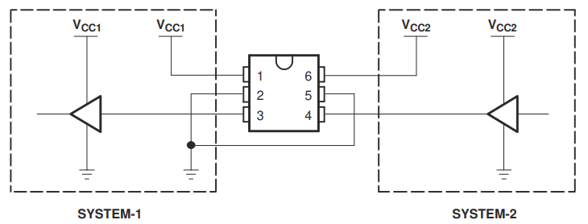  
Typical unidirectional translation between two logic-voltage domains.
</td>
<td align="center" width="50%">
<b>Voltage Translation Waveform</b>  
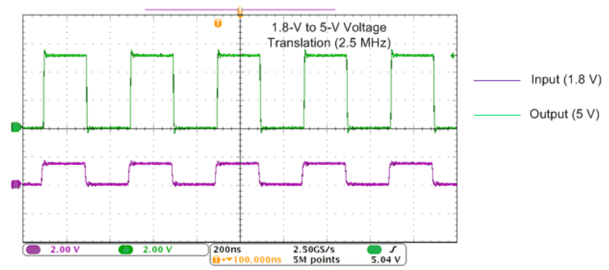  
Example waveform showing logic translation from 1.8 V to 5 V.
</td>
</tr>
</table>

 

  <i>Source: Texas Instruments — SN74LVC1T45 Datasheet.</i>

---

## Local Storage & EEPROM

Local non-volatile memory was included so that important information could remain available even when communication with the remote platform was temporarily unavailable.

The STM32 can use the EEPROM to store information such as system parameters, events or diagnostic data.

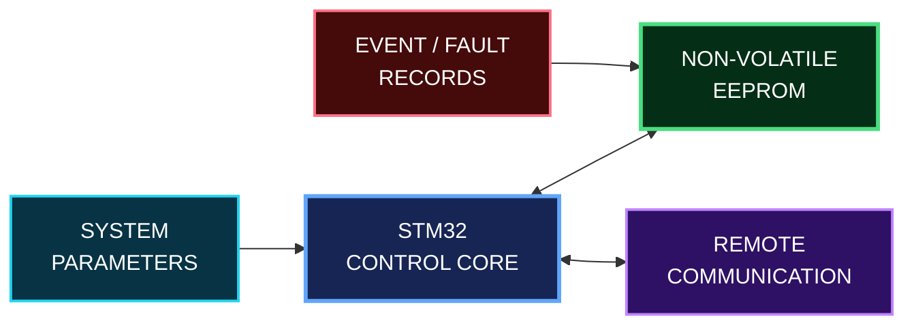

### Design Considerations

- Non-volatile storage for information that must survive a power cycle
- Communication between the STM32 and external memory
- Controlled read and write operations
- Avoiding unnecessary memory writes
- Keeping local information available during communication loss
- Possibility of storing configuration and diagnostic information

> **Local storage gives the system a memory even when the network is unavailable.**

---
 

<h3 align="center">EEPROM Read / Write References</h3>

  
    Reference transactions used to understand page-oriented storage and sequential data access.
  

 

<table>
<tr>
<td align="center" width="50%">
<b>64-Byte Page Write</b>  
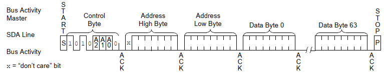  
Page-write sequence used to store multiple bytes in a single EEPROM write operation.
</td>
<td align="center" width="50%">
<b>Sequential Read</b>  
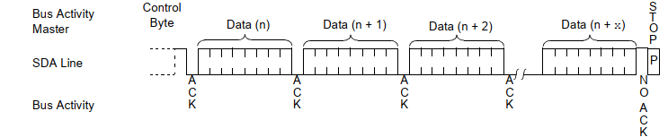  
Sequential access allows consecutive memory locations to be read efficiently.
</td>
</tr>
</table>

 

  <i>Source: Microchip — 24AA256 / 24LC256 / 24FC256 Datasheet.</i>

## Signal Integrity & Controlled Impedance

HyperLynx was used to reproduce the physical PCB stackup and study the electromagnetic behavior of critical communication traces.

The objective was not only to calculate impedance values, but also to visualize how trace geometry, reference planes and spacing influence field distribution and coupling.

### PCB Stackup Model

The physical **JLC04161H-3313** stackup used in the PCB design was reproduced in HyperLynx.

The model included:

- **4 copper layers**
- **35 µm** outer copper
- **15.2 µm** inner copper
- **99.4 µm** prepreg between TOP and GND
- **1.265 mm** FR-4 core
- **L2 GND** as the primary reference plane for top layer controlled impedance traces
- Total modeled thickness of approximately **1.584 mm**

  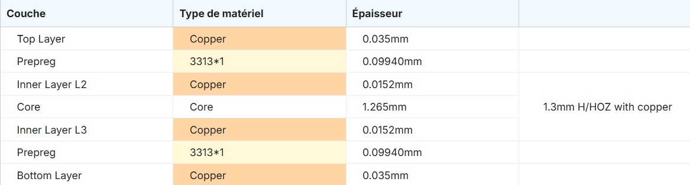
    
  <b>JLC04161H-3313 Stackup Model</b>
   
  Physical 4-layer PCB construction reproduced in HyperLynx.

---

### 50 Ω Trace Coupling Analysis

The 50 Ω top layer traces were evaluated using their real controlled impedance geometry.

The main trace parameters were:

- Trace width: **169.63 µm**
- Reference plane: **L2 GND**
- TOP-to-GND dielectric thickness: **99.4 µm**
- Dielectric constant: approximately **4.1**
- Actual trace separation: **6 mm**

The field solver shows that, with the real 6 mm spacing, most of the electromagnetic field remains concentrated around each trace and its nearby ground reference.

  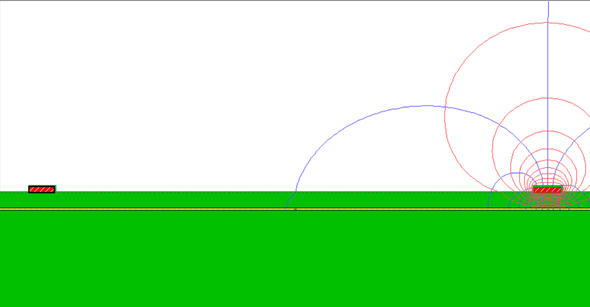
    
  <b>Field Distribution — 6 mm Trace Spacing</b>
   
  Field solver visualization of the controlled-impedance traces using the actual PCB spacing.

To understand the influence of spacing, the same geometry was also evaluated with a reduced separation between the traces.

  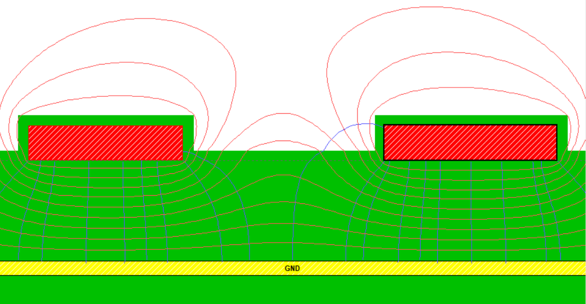
    
  <b>Field Distribution — Reduced Trace Spacing</b>
   
  Comparison case showing stronger electromagnetic interaction when the traces are brought closer together.

The comparison illustrates an important routing principle:

> **Increasing the separation between adjacent controlled-impedance traces reduces electromagnetic interaction and helps limit crosstalk.**

---

### RS485 Differential Impedance Validation

The RS485 A/B pair was also reproduced using its actual routing geometry.

The simulated differential pair used:

- Trace width: **66.82 µm**
- Trace gap: **127 µm**
- Coupled length: approximately **27 mm**
- Routing layer: **TOP**
- Reference plane: **L2 GND**
- Target differential impedance: **120 Ω**

Altium calculated approximately **119.95 Ω**, while the HyperLynx field solver produced approximately **117.3 Ω**.

This corresponds to only about **2.25% deviation** from the 120 Ω target.

  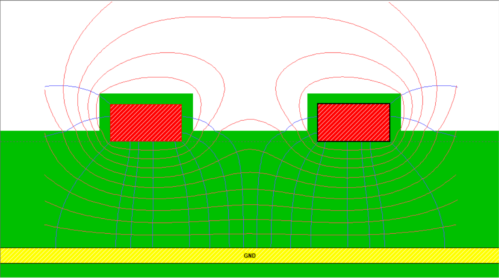
    
  <b>RS-485 Differential Field Distribution</b>
   
  Electromagnetic field distribution of the A/B pair referenced to the L2 ground plane.

Unlike the widely separated 50 Ω traces, electromagnetic interaction between the RS485 conductors is intentional and contributes to the differential behavior of the pair.

> **The simulation confirmed that the implemented RS485 geometry remained close to the 120 Ω differential impedance target.**

